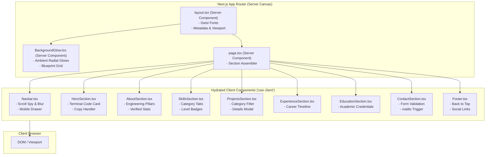
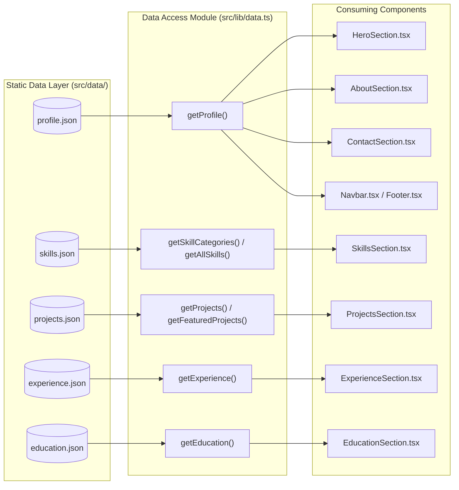
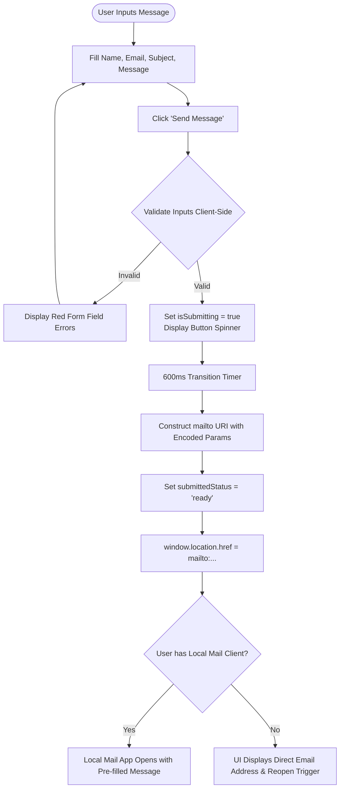
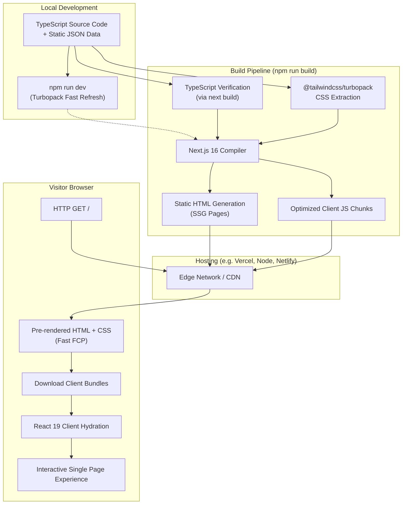

# Portfolio Technical Architecture & Implementation Analysis

**Project Name:** `portfolio`  
**Author & Subject:** Shaik Shahabaz — AI Engineer & Full-Stack Developer  
**Analysis Date:** October 26, 2026  
**Architectural Scope:** Complete Frontend, Data Layer, Component Responsibilities, Configuration, and Infrastructure Analysis  

---

## 1. Executive Summary

This document provides a comprehensive architectural and technical analysis of the personal developer portfolio project for **Shaik Shahabaz**, an AI Engineer and Full-Stack Developer specializing in FastAPI, Python, Flutter, React, PostgreSQL, and LLM semantic integrations.

### Core Architectural Findings

1. **Architecture Model:**
   The application is built on the **Next.js 16.4.3 App Router** paired with **React 19.3.0**, **TypeScript 5**, and **Tailwind CSS v4**. It operates as a modern Jamstack single-page application (SPA) with server-rendered static scaffolding and interactive client-side component hydration.
2. **Data Layer Architecture:**
   The entire application data layer is **static and file-based**. All profile information, skills taxonomies, project case studies, employment records, and academic milestones are persisted in structured JSON files under `src/data/`. There is no runtime database query, external CMS connection, or remote REST/GraphQL data fetching.
3. **Backend & Server Functionality:**
   There are **no custom backend API endpoints**, no Next.js route handlers (`route.ts`), and no Server Actions (`"use server"`). The Next.js server acts strictly as a static pre-renderer and asset server.
4. **Interactive Contact Mechanism:**
   Contact form dispatch operates entirely on the client side. Form submissions perform input validation in the browser and invoke a pre-formatted `mailto:` URI scheme that launches the visitor's local mail client. No database writes or third-party email API gateways (such as Resend or SendGrid) are wired to the form.
5. **Styling & Design System:**
   The project implements a bespoke, dark-themed UI adhering to modern glassmorphism principles (`#08090F` deep obsidian background, violet/indigo accent glows, semi-transparent frosted cards with `backdrop-filter: blur(16px)`, and subtle SVG blueprint grids). Tailwind CSS v4 is configured without legacy configuration files (`tailwind.config.js` or `postcss.config.js`), relying on CSS-first `@import "tailwindcss";` and the `@tailwindcss/turbopack` loader via Turbopack rules in `next.config.ts`.
6. **Package Dependencies & Unused Modules:**
   The package manifest declares `motion` (`^14.6.0`), but inspection of the component source code reveals that `motion` is **not imported anywhere** in the application. All transitions and micro-animations currently rely on native CSS transitions and Tailwind utility classes (`animate-pulse`, `animate-spin`, `transition-all`).

---

## 2. Actual Project Directory Tree

The following directory tree represents the actual inspected structure of the repository. Generated directories (`node_modules`, `.next`, `.git`) are omitted from the physical file listing but documented below.

```
portfolio/
├── .gitignore                     # Git ignore rules for Next.js, Node, logs, caches
├── AGENTS.md                      # Framework agent instructions for Next.js 16 canary
├── eslint.config.mjs              # ESLint 9 Flat Config (Core Web Vitals & TypeScript)
├── next-env.d.ts                  # Next.js ambient TypeScript declarations
├── next.config.ts                 # Next.js 16 configuration (Turbopack, PPR, cacheComponents)
├── package.json                   # Project metadata, scripts, and package dependencies
├── package-lock.json              # Deterministic npm dependency lockfile
├── README.md                      # Default framework bootstrap documentation
├── tsconfig.json                  # TypeScript compiler settings and path aliases
├── public/                        # Static assets served directly at root URL
│   ├── file.svg                   # Default Next.js vector icon
│   ├── globe.svg                  # Default Next.js vector icon
│   ├── next.svg                   # Next.js framework brand vector logo
│   ├── vercel.svg                 # Vercel hosting platform brand vector logo
│   └── window.svg                 # Default Next.js vector icon
└── src/                           # Primary application source root
    ├── app/                       # Next.js App Router root
    │   ├── favicon.ico            # Site favicon (15 KB)
    │   ├── globals.css            # Tailwind CSS v4 entry, CSS custom properties, utility classes
    │   ├── layout.tsx             # Root layout: HTML shell, Google fonts, metadata, background
    │   ├── loading.tsx            # Global loading skeleton spinner
    │   ├── not-found.tsx          # Custom 404 error page
    │   └── page.tsx               # Main portfolio landing page composition
    ├── components/                # Modular React UI components
    │   ├── layout/                # Global structural components
    │   │   ├── Footer.tsx         # Site footer: branding, navigation, socials, back-to-top
    │   │   └── Navbar.tsx         # Sticky glass navigation bar, scroll spy, mobile drawer
    │   ├── sections/              # Page content sections
    │   │   ├── AboutSection.tsx   # Professional narrative, engineering pillars, stats
    │   │   ├── ContactSection.tsx # Contact channels, direct email copy, mailto compose form
    │   │   ├── EducationSection.tsx # Academic qualifications, degree info, coursework
    │   │   ├── ExperienceSection.tsx # Career journey timeline with visual node markers
    │   │   ├── HeroSection.tsx    # Headline, CTAs, interactive terminal profile card
    │   │   ├── ProjectsSection.tsx # Filterable projects grid, project details modal
    │   │   └── SkillsSection.tsx  # Categorized technical skills with level badges
    │   └── ui/                    # Reusable visual and design primitives
    │       ├── BackgroundGlow.tsx # Ambient radial gradients and blueprint grid overlay
    │       ├── Badge.tsx          # Multi-variant status and category pill badge
    │       ├── Button.tsx         # Interactive button with variants, sizes, and spinner
    │       ├── Card.tsx           # Glassmorphic container with hover lighting
    │       ├── Container.tsx      # Centered max-width responsive layout container
    │       ├── IconRenderer.tsx   # Dynamic Lucide icon dispatcher and inline brand SVGs
    │       └── SectionHeader.tsx  # Standard section title, badge, and gradient highlight
    ├── data/                      # Static JSON content repository
    │   ├── education.json         # Academic credentials and coursework records
    │   ├── experience.json        # Professional history and engineering milestones
    │   ├── profile.json           # Bio, headline, availability, contact, pillars, socials
    │   ├── projects.json          # Featured projects, technical summaries, architecture
    │   └── skills.json            # Categorized skills taxonomy with proficiency ratings
    ├── lib/                       # Utility functions and data access layer
    │   ├── data.ts                # Strongly typed accessor functions for static JSON
    │   └── utils.ts               # Class merging helper (cn) and smooth scroll utility
    └── types/                     # TypeScript interface definitions
        └── portfolio.ts           # Domain models for profile, skills, projects, experience
```

### Purpose and Classification of Every File

| File Path | Role Classification | Purpose in Architecture |
| :--- | :--- | :--- |
| `.gitignore` | Configuration | Defines files and folders excluded from Git version control. |
| `AGENTS.md` | Documentation / Tooling | Instructions injected by `next dev` regarding breaking changes in Next.js 16. |
| `eslint.config.mjs` | Tooling / Configuration | ESLint 9 flat configuration extending Next.js Core Web Vitals and TypeScript rules. |
| `next-env.d.ts` | Type Definition / Generated | Auto-generated TypeScript ambient types for Next.js image loading and App Router routes. |
| `next.config.ts` | Configuration | Next.js build and runtime configuration specifying Turbopack CSS loaders and experimental flags. |
| `package.json` | Configuration / Manifest | Declares project metadata, npm scripts, runtime dependencies, and dev dependencies. |
| `package-lock.json` | Tooling / Lockfile | Locks exact dependency versions and integrity hashes for reproducible npm installations. |
| `README.md` | Documentation | Standard starter README generated by `create-next-app`. |
| `tsconfig.json` | Configuration | TypeScript compiler settings, path mapping (`@/*`), strict mode, and JSX processing. |
| `public/*.svg` | Static Content | Default SVG assets (file, globe, next, vercel, window) from initial Next.js scaffolding. |
| `src/app/favicon.ico` | Static Content | Browser tab icon displayed in bookmarks and tab headers. |
| `src/app/globals.css` | Source Code (Styles) | Primary stylesheet importing Tailwind CSS v4, defining CSS custom properties and utility classes. |
| `src/app/layout.tsx` | Source Code (Server Component) | Root HTML shell, Geist font loader, global metadata, Viewport, and ambient background. |
| `src/app/loading.tsx` | Source Code (Server Component) | Fallback loading component rendered during React Suspense transitions. |
| `src/app/not-found.tsx` | Source Code (Server Component) | Custom 404 error page displayed when routes do not resolve. |
| `src/app/page.tsx` | Source Code (Server Component) | Root landing page orchestrating the layout and section components in vertical sequence. |
| `src/components/layout/Navbar.tsx` | Source Code (Client Component) | Fixed top navigation bar with scroll tracking, section spy, and mobile drawer. |
| `src/components/layout/Footer.tsx` | Source Code (Client Component) | Page footer with back-to-top trigger, navigation shortcuts, and external profile links. |
| `src/components/sections/HeroSection.tsx` | Source Code (Client Component) | Hero banner with personal headline, availability pill, CTAs, and interactive terminal card. |
| `src/components/sections/AboutSection.tsx` | Source Code (Client Component) | Biographical summary, engineering pillars, and academic/domain metric cards. |
| `src/components/sections/SkillsSection.tsx` | Source Code (Client Component) | Interactive categorized skills grid with category filtering and proficiency badges. |
| `src/components/sections/ProjectsSection.tsx` | Source Code (Client Component) | Project showcase with category filters, project cards, and detailed modal dialogs. |
| `src/components/sections/ExperienceSection.tsx` | Source Code (Client Component) | Timeline of professional roles, responsibilities, and technology tags. |
| `src/components/sections/EducationSection.tsx` | Source Code (Client Component) | Academic credentials, degree details, completion years, and coursework areas. |
| `src/components/sections/ContactSection.tsx` | Source Code (Client Component) | Contact information, email clipboard copy, and interactive mailto compose form. |
| `src/components/ui/BackgroundGlow.tsx` | Source Code (Server Component) | Fixed background decorative element rendering blurred radial glows and blueprint grid. |
| `src/components/ui/Badge.tsx` | Source Code (UI Primitive) | Reusable inline badge component supporting 6 color themes and 3 sizes. |
| `src/components/ui/Button.tsx` | Source Code (UI Primitive) | Accessible button primitive supporting multiple visual variants and loading spinners. |
| `src/components/ui/Card.tsx` | Source Code (UI Primitive) | Glassmorphic card surface with subtle border highlighting and hover elevation. |
| `src/components/ui/Container.tsx` | Source Code (UI Primitive) | Layout wrapper establishing uniform max-width and horizontal padding across viewports. |
| `src/components/ui/IconRenderer.tsx` | Source Code (Client Component) | Icon mapper that resolves icon names to Lucide components or custom brand SVGs. |
| `src/components/ui/SectionHeader.tsx` | Source Code (UI Primitive) | Standardized section header rendering pill badges, titles, and purple gradient highlights. |
| `src/data/profile.json` | Static Content (Data) | JSON data for profile details, bio, interests, stats, pillars, and social URLs. |
| `src/data/skills.json` | Static Content (Data) | JSON data structuring 6 technical skill categories and individual competencies. |
| `src/data/projects.json` | Static Content (Data) | JSON data containing 4 technical project case studies and architecture specs. |
| `src/data/experience.json` | Static Content (Data) | JSON data containing 2 professional work experience entries. |
| `src/data/education.json` | Static Content (Data) | JSON data containing 3 verified academic milestones and coursework lists. |
| `src/lib/data.ts` | Source Code (Data Access) | Strongly typed data access layer importing JSON files and returning typed models. |
| `src/lib/utils.ts` | Source Code (Utilities) | Utility functions for Tailwind class merging (`cn`) and smooth DOM element scrolling. |
| `src/types/portfolio.ts` | Type Definition | TypeScript interfaces establishing compile-time schemas for all portfolio entities. |

### Explanation of Excluded Generated Directories

The following directories exist or are generated during development and build cycles, but are excluded from inspection:

1. **`node_modules/`**: Contains third-party package dependencies installed by npm based on `package.json` and resolved in `package-lock.json`. These include Next.js binaries, React runtime libraries, TypeScript compiler modules, ESLint rules, and Tailwind CSS engines.
2. **`.next/`**: The Next.js compilation cache and build artifact directory. When `npm run dev` or `npm run build` executes, Next.js generates compiled server bundles, client-side JavaScript chunks, route manifests, CSS bundles, server-side render cache, and TypeScript route helpers here.
3. **`.git/`**: The internal Git directory containing Git version history, commit objects, branch pointers, HEAD references, and remote repository metadata.

---

## 3. Root Configuration Analysis

### `package.json` Specification

```json
{
  "name": "portfolio",
  "version": "0.1.0",
  "private": true,
  "scripts": {
    "dev": "next dev",
    "build": "next build",
    "start": "next start",
    "lint": "eslint"
  },
  "dependencies": {
    "clsx": "^2.1.1",
    "lucide-react": "^1.61.0",
    "motion": "^14.6.0",
    "next": "16.4.3",
    "react": "19.3.0",
    "react-dom": "19.3.0",
    "tailwind-merge": "^3.7.0"
  },
  "devDependencies": {
    "@tailwindcss/turbopack": "^4",
    "@types/node": "^20",
    "@types/react": "^19",
    "@types/react-dom": "^19",
    "eslint": "^9",
    "eslint-config-next": "16.4.3",
    "tailwindcss": "^4",
    "typescript": "^5"
  }
}
```

#### Declared Scripts
- `"dev": "next dev"`: Starts the local Next.js development server with Turbopack fast refresh.
- `"build": "next build"`: Compiles the Next.js application for production, generating optimized server bundles, static HTML, and client assets.
- `"start": "next start"`: Launches the Next.js production HTTP server to serve the pre-built application from `.next/`.
- `"lint": "eslint"`: Runs the ESLint 9 linter across project source files using `eslint.config.mjs`.

#### Dependency vs DevDependency Architectural Boundary
- **`dependencies` (Runtime):** Packages bundled into the server runtime or shipped to the browser client during page execution. For example, `react`, `react-dom`, and `next` provide the UI framework runtime; `clsx` and `tailwind-merge` handle runtime className concatenation; `lucide-react` provides icon SVG rendering.
- **`devDependencies` (Build & Tooling):** Packages used exclusively during local development, type checking, linting, and build-time bundling. TypeScript, type definitions (`@types/*`), ESLint, and Tailwind CSS build loaders do not execute as runtime dependencies in the user's browser.

#### Script Gaps
- **No dedicated TypeScript verification script:** There is no `"typecheck": "tsc --noEmit"` script configured in `package.json`. TypeScript type checking occurs during `next build`, but cannot be run independently via an npm script alias without invoking `npx tsc --noEmit`.

#### Lockfile Presence
- `package-lock.json` is present in the project root (237,708 bytes), establishing npm as the primary package manager.

---

### `tsconfig.json` Compiler Specification

```json
{
  "compilerOptions": {
    "target": "ES2017",
    "lib": ["dom", "dom.iterable", "esnext"],
    "allowJs": true,
    "skipLibCheck": true,
    "strict": true,
    "noEmit": true,
    "esModuleInterop": true,
    "module": "esnext",
    "moduleResolution": "bundler",
    "resolveJsonModule": true,
    "isolatedModules": true,
    "jsx": "react-jsx",
    "incremental": true,
    "plugins": [
      {
        "name": "next"
      }
    ],
    "paths": {
      "@/*": ["./src/*"]
    }
  },
  "include": [
    "next-env.d.ts",
    "**/*.ts",
    "**/*.tsx",
    ".next/types/**/*.ts",
    ".next/dev/types/**/*.ts",
    "**/*.mts"
  ],
  "exclude": ["node_modules"]
}
```

#### Key Compiler Directives
- **`strict: true`**: Enforces strict null checking, strict property initialization, and disallows implicit `any` types across all source files.
- **`moduleResolution: "bundler"`**: Modern TypeScript module resolution strategy aligned with modern bundlers (Turbopack, Vite, Webpack 5), supporting package `exports` map resolution.
- **`paths: { "@/*": ["./src/*"] }`**: Configures the `@` path alias, allowing imports like `@/components/...` or `@/lib/...` rather than fragile relative directory traversal (`../../`).
- **`resolveJsonModule: true`**: Permits direct static importing of `.json` files as typed JavaScript objects, powering the data layer in `src/lib/data.ts`.
- **`jsx: "react-jsx"`**: Uses React 17+ automated JSX runtime transform (`import { jsx } from 'react/jsx-runtime'`), eliminating manual `import React from 'react'` requirements for JSX compilation.
- **`noEmit: true`**: Prevents TypeScript from writing `.js` output to disk, delegating transpilation entirely to Next.js Turbopack.

---

### `next.config.ts` Configuration

```typescript
import type { NextConfig } from "next";

const nextConfig: NextConfig = {
  cacheComponents: true,
  partialPrefetching: true,
  turbopack: {
    rules: {
      "*.css": {
        loaders: ["@tailwindcss/turbopack"],
        as: "*.css",
      },
    },
  },
};

export default nextConfig;
```

#### Architectural Implications
1. **`cacheComponents: true`**: An experimental Next.js 16 caching flag that optimizes component rendering caching across server render passes.
2. **`partialPrefetching: true` (PPR)**: Next.js Partial Prerendering and prefetching, allowing static layout shells to be served instantly while dynamic segments stream concurrently.
3. **`turbopack` Rules**: Explicitly instructs Next.js Turbopack to process all `*.css` files through the `@tailwindcss/turbopack` loader. This enables native Tailwind CSS v4 support without requiring a standalone `postcss.config.js` or `postcss` runner.

---

### Tailwind CSS v4 & PostCSS Configuration

A critical architectural detail of this repository is the **absence of `tailwind.config.js` and `postcss.config.js`**.

In **Tailwind CSS v4**, configuration has shifted from JavaScript configuration files to **CSS-first configuration**. The styling pipeline is activated in `src/app/globals.css` with:
```css
@import "tailwindcss";
```
The Next.js Turbopack engine processes this import directly through `@tailwindcss/turbopack`. All design tokens, custom utility classes, and theme variables are declared directly in CSS rather than in a JavaScript export.

---

### `eslint.config.mjs` Configuration

The project implements ESLint 9's Flat Config architecture:
```javascript
import { defineConfig, globalIgnores } from "eslint/config";
import nextVitals from "eslint-config-next/core-web-vitals";
import nextTs from "eslint-config-next/typescript";

const eslintConfig = defineConfig([
  ...nextVitals,
  ...nextTs,
  globalIgnores([
    ".next/**",
    "out/**",
    "build/**",
    "next-env.d.ts",
  ]),
]);

export default eslintConfig;
```
It bundles `eslint-config-next/core-web-vitals` (which enforces rules regarding image optimization, font display, and link navigation) and `eslint-config-next/typescript` (which enforces TypeScript syntax and type safety), while ignoring build artifacts and generated files.

---

## 4. Deep Inspection of `src/app`

### `src/app/layout.tsx` (Root Layout)
- **Role:** Server Component. Root HTML structure for the entire application.
- **HTML Structure:**
  Renders `<html lang="en" suppressHydrationWarning className="... dark scroll-smooth">` wrapping `<body suppressHydrationWarning className="min-h-screen bg-[#08090F] text-[#F5F5F7] font-sans antialiased selection:bg-purple-600/30 selection:text-white relative">`.
- **Font Optimization:**
  Uses `next/font/google` to instantiate `Geist` (sans-serif) and `Geist_Mono` (monospace) with CSS variable injection (`--font-geist-sans`, `--font-geist-mono`). Fonts are downloaded at build time and self-hosted with zero layout shift (CLS).
- **Metadata & OpenGraph:**
  Exports a static `Viewport` object specifying `themeColor: "#08090F"`, `width: "device-width"`, and `initialScale: 1`.  
  Exports a `Metadata` object declaring the site title (`"Shaik Shahabaz | AI Engineer & Full-Stack Developer"`), description, keywords, OpenGraph card metadata (`og:title`, `og:description`, `og:type`), Twitter summary card metadata, and icon references.
- **Background Layering:**
  Renders the `<BackgroundGlow />` component as the first child of `<body>`, establishing the global ambient dark gradient backdrop beneath all routed content.
- **Boundary Classification:**
  `layout.tsx` is an async-capable Server Component. It does not import React client hooks.

---

### `src/app/page.tsx` (Home Landing Page)
- **Role:** Server Component.
- **Composition & Section Order:**
  Renders the single-page layout hierarchy:
  1. `<Navbar />` (Client Component — sticky header)
  2. `<main>` content container:
     - `<HeroSection />`
     - `<AboutSection />`
     - `<SkillsSection />`
     - `<ProjectsSection />`
     - `<ExperienceSection />`
     - `<EducationSection />`
     - `<ContactSection />`
  3. `<Footer />` (Client Component — site footer)
- **Props & Data Passing:**
  `page.tsx` passes **no props** to its child section components. Each section component independently calls data access helpers from `@/lib/data` (e.g., `getProfile()`, `getProjects()`, `getSkillCategories()`).
- **Server vs Client Boundary:**
  `page.tsx` itself has no `"use client"` directive, allowing Next.js to render the outer container and layout tree on the server. The individual section components carry `"use client"` directives for localized browser interactions.

---

### `src/app/globals.css` (Global Stylesheet)
The global stylesheet defines:
1. **Tailwind v4 Initialization:** `@import "tailwindcss";`
2. **CSS Custom Properties (`:root`):**
   - `--background: #08090f;` (Deep charcoal/black primary canvas)
   - `--secondary-bg: #0d101a;` (Card and panel surface background)
   - `--foreground: #f5f5f7;` (Off-white primary text color)
   - `--muted: #a1a1aa;` (Neutral secondary text)
   - `--accent-primary: #a78bfa;` (Light purple accent)
   - `--accent-secondary: #818cf8;` (Indigo accent)
   - `--card-bg: rgba(255, 255, 255, 0.035);`
   - `--border-subtle: rgba(255, 255, 255, 0.1);`
3. **HTML & Typography Rules:**
   `scroll-behavior: smooth;`, `color-scheme: dark;`, and `font-feature-settings: "cv02", "cv03", "cv04", "cv11";` for enhanced OpenType character legibility.
4. **Custom Dark Scrollbar:**
   8px width with semi-transparent track and hover-activated purple thumb (`rgba(167, 139, 250, 0.4)`).
5. **Glassmorphism & Gradient Utilities:**
   - `.gradient-text-purple`: Creates a multi-stop linear gradient (`#c084fc` to `#a78bfa` to `#818cf8`) clipped to text.
   - `.glass-panel`: Applies `backdrop-filter: blur(16px)` over `rgba(13, 16, 26, 0.7)` with subtle border highlights.

---

### `src/app/loading.tsx` (Loading Fallback UI)
- **Role:** Server Component.
- **Behavior:** Automatically rendered by the Next.js App Router boundary when route segments or Suspense boundaries are in an unresolved asynchronous state.
- **UI:** Fullscreen dark canvas (`min-h-screen bg-[#08090F]`) featuring a dual-ring CSS spinner (outer subtle border, inner spinning purple accent border) and a monospace uppercase label: `"LOADING PORTFOLIO..."`.

---

### `src/app/not-found.tsx` (Custom 404 Error Page)
- **Role:** Server Component.
- **Behavior:** Rendered by Next.js when `notFound()` is invoked or an unknown URL path is requested.
- **UI:** Displays ambient `<BackgroundGlow />`, a large monospace `"404"` with purple text gradient, an explanatory message, and a styled Next.js `<Link href="/">` button returning visitors to the home portfolio.

---

### `src/app/favicon.ico`
- **Role:** Static binary icon asset (15,086 bytes) located at the App Router root.
- **Function:** Automatically served by Next.js at `/favicon.ico` for browser tab identification and search engine result branding.

---

## 5. Layout Components Analysis

### `src/components/layout/Navbar.tsx`

```typescript
"use client";
import React, { useState, useEffect } from "react";
import { getProfile, getNavigationItems } from "@/lib/data";
import { IconRenderer } from "@/components/ui/IconRenderer";
import { scrollToSection } from "@/lib/utils";
```

#### Detailed Architecture & State
- **Purpose:** Fixed top navigation header providing responsive brand identity, active section tracking, smooth scrolling navigation, mobile drawer controls, and resume access.
- **State Variables:**
  - `activeSection: string` (Defaults to `"home"`): Tracks the currently visible page section based on scroll offset.
  - `isScrolled: boolean` (Defaults to `false`): Flips to `true` when `window.scrollY > 20`, activating a blurred dark background (`bg-[#08090F]/85 backdrop-blur-md`), a subtle border, and box-shadow.
  - `mobileMenuOpen: boolean` (Defaults to `false`): Toggles the responsive mobile navigation menu drawer.
  - `resumeNotice: boolean` (Defaults to `false`): Toggles an informational popover explaining how to activate resume downloads if `profile.hasResume` is false.
- **Hooks & Side Effects:**
  - `useEffect`: Binds a passive scroll event listener (`window.addEventListener("scroll", handleScroll, { passive: true })`). Calculates `window.scrollY + 200` and iterates over section DOM IDs in reverse order to detect the currently active section. Cleans up the listener on unmount.
- **Navigation Handler:**
  - `handleNavClick(e, href)`: Prevents browser hash jumping (`e.preventDefault()`), delegates to `scrollToSection(href)` for smooth animated scrolling, and closes the mobile drawer if open.
- **Resume Handler:**
  - `handleResumeClick(e)`: Checks `profile.hasResume`. If false, cancels link activation and displays the `resumeNotice` popover for 3.5 seconds before auto-dismissing.
- **Accessibility:**
  - Navigation links have explicit text and semantic `<nav>` wrappers.
  - Mobile menu toggle button includes `aria-label` and dynamic `aria-expanded` attributes.

---

### `src/components/layout/Footer.tsx`

```typescript
"use client";
import React from "react";
import { getProfile, getNavigationItems } from "@/lib/data";
import { IconRenderer } from "@/components/ui/IconRenderer";
import { scrollToSection } from "@/lib/utils";
```

#### Detailed Architecture & State
- **Purpose:** Renders the bottom boundary of the page containing the engineer's brand headline, two-column navigation link directory, external social profile links, copyright notice, and a "Back to top" button.
- **State & Hooks:** Stateless functional component using client handlers.
- **Event Handlers:**
  - `handleNavClick(e, href)`: Smooth-scrolls to anchor targets via `scrollToSection(href)`.
  - `handleBackToTop()`: Triggers `window.scrollTo({ top: 0, behavior: "smooth" })`.
- **Dynamic Content:**
  Calculates the current calendar year via `new Date().getFullYear()` to ensure copyright claims remain current without manual code updates.
- **External Link Security:**
  All external social links specify `target="_blank"` and `rel="noopener noreferrer"` to prevent tab-napping and unauthorized `window.opener` manipulation.

---

## 6. Section Components Analysis

### 1. `HeroSection.tsx`
- **What it Displays:** Top hero banner featuring an availability indicator pill (`profile.availability`), greeting, full name (`profile.name`), headline (`profile.primaryTitle`), short bio, location details, collaboration status, 3 primary action buttons, external social icon row, and an interactive syntax-highlighted code card.
- **Imports:** `useState`, `getProfile()`, `IconRenderer`, `scrollToSection`.
- **State & Interactions:**
  - `copiedCode: boolean`: Tracks whether the terminal code snippet was copied to the clipboard. `handleCopyCode()` uses `navigator.clipboard.writeText(terminalCode)` and displays a `"Copied!"` badge for 2 seconds.
  - `resumeNotice: boolean`: Displays an advisory popover if the visitor clicks "Download Resume" while `profile.hasResume` is `false`.
- **Styling:** Two-column CSS grid (7 columns left, 5 columns right on `lg:` viewports). Terminal card features simulated macOS window control dots (rose, amber, emerald), monospace typography, and syntax highlighting via color-coded `<span>` elements.
- **Confirmed Limitation:** The terminal snippet is hardcoded within `HeroSection.tsx` rather than generated from `profile.json` or `skills.json`.

---

### 2. `AboutSection.tsx`
- **What it Displays:** Detailed professional narrative paragraphs, core engineering focus tags, 4 verified metric/stat cards, and 4 high-level engineering pillar cards (AI & LLM Integration, Backend & API Engineering, Full-Stack & Mobile Development, Databases & Data Engineering).
- **Data Dependencies:** Consumes `profile.introduction`, `profile.interests`, `profile.stats`, and `profile.pillars` via `getProfile()`.
- **State & Hooks:** Pure presentational client component; no internal state.
- **Styling:** CSS grid with `Card` wrappers, purple gradient values, and badge highlights.

---

### 3. `SkillsSection.tsx`
- **What it Displays:** Complete technical skills matrix grouped into 6 categories, with category filter tabs and individual proficiency tags.
- **Data Dependencies:** Consumes `getSkillCategories()` from `@/lib/data`.
- **State & Hooks:**
  - `selectedCategory: string` (Default: `"all"`): Filters the displayed categories.
- **Interactions:**
  - Clicking a category tab updates `selectedCategory`, re-rendering the grid to show only matching skills or all skills.
  - `getLevelBadgeVariant(level)`: Maps proficiency strings (`Core`, `Advanced`, `Proficient`, `Practical`) to corresponding `Badge` color variants (`purple`, `emerald`, `amber`, `neutral`).

---

### 4. `ProjectsSection.tsx`
- **What it Displays:** Grid of engineering projects, category filter pills, project cards with status badges and category icons, and an interactive project details modal dialog.
- **Data Dependencies:** Consumes `getProjects()` from `@/lib/data`.
- **State & Hooks:**
  - `selectedCategory: string` (Default: `"All"`): Filters projects by category (`"Mobile Applications"`, `"Full-Stack Applications"`, `"AI Applications"`, `"Data Engineering"`).
  - `activeModalProject: Project | null` (Default: `null`): Holds the active project selected for deep inspection in a modal dialog.
  - `useEffect`: Manages modal keyboard events and background scroll locking. When `activeModalProject` is truthy, it sets `document.body.style.overflow = "hidden"` and listens for the `Escape` key to close the modal. On close or unmount, it resets `document.body.style.overflow = "unset"`.
- **Interactions & Modals:**
  - Card button "View Details" opens the modal dialog.
  - Clicking the modal backdrop or "X" button invokes `setActiveModalProject(null)`.
  - Conditional rendering: If a project lacks `githubUrl` or `liveUrl`, those external links are omitted from both the card and modal.

---

### 5. `ExperienceSection.tsx`
- **What it Displays:** Career timeline showcasing professional roles, companies, employment types, geographic locations, dates, key responsibilities, and technology tags.
- **Data Dependencies:** Consumes `getExperience()` from `@/lib/data`.
- **State & Hooks:** Pure presentational client component.
- **Styling:** Left-aligned glowing vertical gradient line (`from-purple-500/60 via-indigo-500/40 to-transparent`) paired with circular node markers (`w-4 h-4 rounded-full bg-purple-600 shadow-[0_0_12px_rgba(168,85,247,0.8)]`).
- **Confirmed Limitation:** As declared in `src/data/experience.json`, company names are currently bracketed placeholders (`"[Organization / Company Name]"`, `"[Independent Engineering / Client Projects]"`), marked with `"isVerified": false`.

---

### 6. `EducationSection.tsx`
- **What it Displays:** Three-card academic credentials grid representing the Bachelor of Science (B.Sc.), Higher Secondary/Intermediate, and Secondary School Certificate (SSC).
- **Data Dependencies:** Consumes `getEducation()` from `@/lib/data`.
- **State & Hooks:** Pure presentational client component.
- **Card Content:** Displays graduation year, academic aggregate score (76%, 86%, 83%), degree title, institution name, descriptive summary, and individual coursework chips.

---

### 7. `ContactSection.tsx`
- **What it Displays:** Direct communication cards (email address with copy button, location, interview readiness, social channels) and an interactive email composition form.
- **Data Dependencies:** Consumes `getProfile()` from `@/lib/data`.
- **State Variables:**
  - `formData: FormState`: Object containing `name`, `email`, `subject`, and `message`.
  - `errors: FormErrors`: Tracks field-specific validation error strings.
  - `isSubmitting: boolean`: Controls loading spinner state on the submit button.
  - `submittedStatus: "idle" | "ready" | "copied"`: Manages post-submission confirmation states.
  - `copiedEmail: boolean`: Temporarily displays confirmation when the user copies the email address to clipboard.
- **Validation Logic:**
  - `name`: Must be non-empty after trimming.
  - `email`: Must be non-empty and match standard regex `/^[^\s@]+@[^\s@]+\.[^\s@]+$/`.
  - `subject`: Must be non-empty after trimming.
  - `message`: Must be at least 10 characters in length.
- **Submission Workflow & Runtime Reality:**
  When `handleSubmit` is called and validation passes:
  1. `setIsSubmitting(true)` is activated.
  2. A 600ms timer simulates processing.
  3. `submittedStatus` is set to `"ready"`.
  4. The component synthesizes a standard `mailto:` URL with URL-encoded recipient, subject, and body parameters:
     ```typescript
     window.location.href = `mailto:${encodeURIComponent(profile.email)}?subject=${encodeURIComponent(
       `[Portfolio Inquiry] ${formData.subject}`
     )}&body=${encodeURIComponent(
       `Hello Shaik,\n\n${formData.message}\n\n---\nFrom: ${formData.name}\nEmail: ${formData.email}`
     )}`;
     ```
  5. The visitor's default desktop or mobile mail client is launched. If no local mail client is configured, the UI presents an explicit fallback allowing the user to copy or retry.
  - **Confirmed Limitation:** No network transmission occurs to an API server or database.

---

## 7. Reusable UI Components Analysis (`src/components/ui`)

### `BackgroundGlow.tsx`
- **Role:** Server Component (no client hooks).
- **Responsibility:** Injects 3 high-radius blurred radial gradients (`w-[700px] bg-purple-600/15`, `w-[500px] bg-indigo-600/10`, `w-[550px] bg-purple-800/12`) with `will-change-transform` and a 64px by 64px subtle SVG blueprint grid overlay.
- **Performance:** Marked `aria-hidden="true"` and `pointer-events-none -z-10`, ensuring zero interaction overhead and zero interference with assistive tech.

### `Badge.tsx`
- **Role:** Server/Client agnostic visual primitive.
- **Props:** `variant` (`default`, `purple`, `emerald`, `amber`, `neutral`, `cyan`), `size` (`sm`, `md`, `lg`), `children`, `className`.
- **Styling:** Combines backdrop blur, subtle borders, and optional glow drop shadows (`shadow-[0_0_12px_rgba(...)]`).

### `Button.tsx`
- **Role:** Reusable button primitive.
- **Props:** Extends `React.ButtonHTMLAttributes<HTMLButtonElement>`. Accepts `variant` (`primary`, `secondary`, `outline`, `ghost`), `size` (`sm`, `md`, `lg`), `isLoading`, `disabled`.
- **Features:** Injects an animated SVG circular spinner when `isLoading` is true, automatically setting `disabled` and preventing double-clicks. Implements accessible focus rings (`focus-visible:ring-2 focus-visible:ring-purple-500`).

### `Card.tsx`
- **Role:** Glassmorphism card container.
- **Props:** `glow` (boolean), `hoverEffect` (boolean), `children`, `className`.
- **Defaults:** `glow = false`, `hoverEffect = true`.
- **Styling:** `bg-[#0D101A]/80 border border-white/[0.08] backdrop-blur-xl p-6`. Hover effect applies a subtle purple border transition and box shadow.

### `Container.tsx`
- **Role:** Responsive grid alignment container.
- **Styling:** `max-w-6xl mx-auto px-4 sm:px-6 lg:px-8 w-full`. Standardizes viewport padding across all breakpoints.

### `IconRenderer.tsx`
- **Role:** Client Component (`"use client"`).
- **Responsibility:** Decouples icon name strings stored in JSON data files from physical React icon components.
- **Brand SVG Handling:** Normalizes strings. If the icon name is `"github"` or `"linkedin"`, it bypasses external libraries and directly renders custom, pixel-perfect brand SVG paths.
- **Lucide Icon Mapping:** Maps over 45 normalized string tokens (e.g., `sparkles`, `server`, `database`, `cpu`, `workflow`) to corresponding Lucide React components.
- **Fallback Behavior:** If an unknown icon name is supplied, it falls back gracefully to `LucideIcons.Code2`, preventing runtime crashes.

### `SectionHeader.tsx`
- **Role:** Section header layout primitive.
- **Props:** `badge`, `title`, `highlightedWord`, `subtitle`, `align` (`center` | `left`), `className`.
- **Styling:** Formats section titles with responsive typography (`text-3xl sm:text-4xl lg:text-5xl`) and applies a gradient clip (`bg-gradient-to-r from-purple-400 via-violet-300 to-indigo-400 bg-clip-text text-transparent`) to `highlightedWord`.

---

## 8. Component Responsibility Matrix

| Component | File Path | Component Type | State & Hooks | Primary Data Source | Key User Interactions |
| :--- | :--- | :--- | :--- | :--- | :--- |
| **`RootLayout`** | `src/app/layout.tsx` | Server Component | None | None | Page bootstrapping, font loading |
| **`Home`** | `src/app/page.tsx` | Server Component | None | None | Assembles section hierarchy |
| **`Loading`** | `src/app/loading.tsx` | Server Component | None | None | Suspense transition display |
| **`NotFound`** | `src/app/not-found.tsx` | Server Component | None | None | 404 route handling, home navigation |
| **`Navbar`** | `src/components/layout/Navbar.tsx` | Client Component | `useState` (4), `useEffect` | `profile.json` | Smooth scroll, scroll spy, drawer, resume |
| **`Footer`** | `src/components/layout/Footer.tsx` | Client Component | None | `profile.json` | Navigation links, back-to-top scroll |
| **`HeroSection`** | `src/components/sections/HeroSection.tsx` | Client Component | `useState` (2) | `profile.json` | Code copy, resume notice, CTA scrolls |
| **`AboutSection`** | `src/components/sections/AboutSection.tsx` | Client Component | None | `profile.json` | Narrative browsing, pillar inspection |
| **`SkillsSection`** | `src/components/sections/SkillsSection.tsx` | Client Component | `useState` (1) | `skills.json` | Category tab filtering |
| **`ProjectsSection`** | `src/components/sections/ProjectsSection.tsx` | Client Component | `useState` (2), `useEffect` | `projects.json` | Project filter, modal view, Esc key close |
| **`ExperienceSection`** | `src/components/sections/ExperienceSection.tsx` | Client Component | None | `experience.json` | Career timeline inspection |
| **`EducationSection`** | `src/components/sections/EducationSection.tsx` | Client Component | None | `education.json` | Academic background review |
| **`ContactSection`** | `src/components/sections/ContactSection.tsx` | Client Component | `useState` (5) | `profile.json` | Form validation, clipboard, mailto launch |
| **`BackgroundGlow`** | `src/components/ui/BackgroundGlow.tsx` | Server Component | None | None | Ambient visual canvas |
| **`Badge`** | `src/components/ui/Badge.tsx` | UI Primitive | None | Props | Visual categorization indicator |
| **`Button`** | `src/components/ui/Button.tsx` | UI Primitive | None | Props | Clicks, loading state feedback |
| **`Card`** | `src/components/ui/Card.tsx` | UI Primitive | None | Props | Hover lighting, surface container |
| **`Container`** | `src/components/ui/Container.tsx` | UI Primitive | None | Props | Viewport boundary constraint |
| **`IconRenderer`** | `src/components/ui/IconRenderer.tsx` | Client Component | None | Props | Icon name resolution & SVG rendering |
| **`SectionHeader`** | `src/components/ui/SectionHeader.tsx` | UI Primitive | None | Props | Section headings & badge display |

---

## 9. Data Layer & Data Flow Analysis

### Inspection of Data Files (`src/data/*.json`)

1. **`profile.json`**:
   - Contains personal data: `name`, `primaryTitle`, `alternativeHeadline`, `introduction` array, `location`, `locationDetails`, `availability`, `email`, `hasResume` (`false`), `resumeUrl`, `interests` array, `stats` array (4 metrics), `pillars` array (4 pillars), and `socials` array (GitHub, LinkedIn, Email).
   - **Editing Safety:** Adding new social profiles or modifying bio paragraphs is safe and immediately reflected upon rebuild.
2. **`skills.json`**:
   - Contains an array of 6 categories (`ai-search`, `backend`, `frontend-mobile`, `languages`, `databases-data`, `tools-cloud`).
   - Each category contains an `id`, `title`, `description`, `icon`, and an array of `skills` objects (`name`, `level`, `icon`, `highlight`).
   - **Editing Safety:** Adding skills or categories automatically updates both the `SkillsSection` filter pills and skills grid without code modification.
3. **`projects.json`**:
   - Array of 4 project case studies:
     - `ezstaf-platform`: Recruitment platform (Flutter, FastAPI, PostgreSQL).
     - `applicant-management-system`: Full-stack candidate pipeline (React, FastAPI, PostgreSQL).
     - `semantic-knowledge-search`: Vector search prototype (Sentence Transformers, Pinecone, FastAPI).
     - `data-engineering-pipeline`: Data ingestion template (Snowflake, AWS S3, PySpark).
   - **Editing Safety:** Adding new project objects requires valid `category` and `status` values matching the TypeScript union types.
4. **`experience.json`**:
   - Array of 2 career entries (`exp-1`, `exp-2`).
   - Contains roles, company names, employment types, date ranges, summaries, bulleted responsibilities, and technologies.
5. **`education.json`**:
   - Array of 3 academic records (`edu-bsc`, `edu-intermediate`, `edu-ssc`).
   - Includes degrees, institutions, graduation years, aggregate percentages, descriptions, and coursework lists.

### Static JSON Bundling Mechanics

In Next.js with `tsconfig.json` option `resolveJsonModule: true`, imported JSON files are parsed at **compile time**.
```typescript
import profileData from "@/data/profile.json";
```
The data is embedded directly into the compiled JavaScript chunks for the client and server bundles.

**Key Implications:**
- **Zero Runtime Fetch Overhead:** No network latency or HTTP requests are incurred to load portfolio data.
- **Rebuild Required:** Any edit to a `.json` file requires running `npm run build` to update the production output bundles. Modifying JSON files on a running production server without rebuilding will have no effect.

---

## 10. Utility & Type Files Analysis

### `src/lib/data.ts`
- **Imports:** Static imports of the 5 JSON files and domain interfaces from `@/types/portfolio`.
- **Exports:**
  - `navigationItems`: Array of 7 navigation link objects (`Home`, `About`, `Skills`, `Projects`, `Experience`, `Education`, `Contact`).
  - `getProfile()`: Returns `profileData as Profile`.
  - `getSkillCategories()`: Returns `skillsData as SkillCategory[]`.
  - `getAllSkills()`: Iterates through categories, deduplicates skills by name using a `Set<string>`, and returns a flat `SkillItem[]`.
  - `getProjects()`: Returns `projectsData as Project[]`.
  - `getFeaturedProjects()`: Filters projects where `featured === true`.
  - `getExperience()`: Returns `experienceData as ExperienceItem[]`.
  - `getEducation()`: Returns `educationData as EducationItem[]`.
  - `getNavigationItems()`: Returns `navigationItems`.
- **Runtime Validation:**
  The functions use TypeScript type assertions (`as Profile`, `as Project[]`). There is no runtime schema parser (such as Zod) verifying JSON integrity at runtime.

### `src/lib/utils.ts`
- **`cn(...inputs: ClassValue[])`**:
  Combines `clsx` (for conditional class toggling) with `tailwind-merge` (which intelligently resolves conflicting Tailwind utility classes, e.g., resolving `p-4` vs `p-6` in favor of the latter).
- **`scrollToSection(sectionId: string)`**:
  Strips any leading `#` symbol, searches the DOM via `document.getElementById()`, and calls `element.scrollIntoView({ behavior: "smooth" })`.

### `src/types/portfolio.ts`
Defines 8 core TypeScript interfaces:
1. `SocialLink`: Defines `platform`, `url`, `label`, `icon`, `isConfigured`.
2. `VerifiedStat`: Defines `value`, `label`, optional `subtext`.
3. `EngineeringPillar`: Defines `title`, `description`, `icon`, `highlights: string[]`.
4. `Profile`: Top-level user profile schema.
5. `SkillItem`: Defines `name`, `level` (Union: `"Core" | "Proficient" | "Advanced" | "Practical" | "Concept"`), `icon`, optional `highlight`.
6. `SkillCategory`: Category schema wrapping an array of `SkillItem`.
7. `Project`: Defines project metadata, including strict `status` union:
   `"Active Architecture" | "Production Workflow" | "Concept / Prototype" | "Pipeline Template"`.
8. `ExperienceItem` & `EducationItem`: Schema for employment and academic entries.

---

## 11. Frontend Architecture & Hydration Lifecycle

### Server vs. Client Boundary Strategy

Next.js App Router enforces Server Components by default. The project applies client directives strategically:

```
[Server Canvas] layout.tsx (HTML, Head, Fonts, Metadata, Body)
      │
      ├── [Server Primitive] BackgroundGlow.tsx (Fixed Ambient Canvas)
      │
      └── [Server Layout] page.tsx (Vertical Section Orchestrator)
            │
            ├── [Client Boundary] Navbar.tsx (Scroll tracking, Section Spy, Drawer)
            ├── [Client Boundary] HeroSection.tsx (Clipboard copy, Popovers, Scroll triggers)
            ├── [Client Boundary] AboutSection.tsx (Pillars & Metrics display)
            ├── [Client Boundary] SkillsSection.tsx (Interactive Category Filter Tabs)
            ├── [Client Boundary] ProjectsSection.tsx (Category Filter, Modal Dialog, Esc listener)
            ├── [Client Boundary] ExperienceSection.tsx (Timeline UI)
            ├── [Client Boundary] EducationSection.tsx (Academic Cards)
            ├── [Client Boundary] ContactSection.tsx (Form validation, State Machine, mailto)
            └── [Client Boundary] Footer.tsx (Smooth Scroll, Back-to-Top)
```

### Why Components Require `"use client"`
1. **`Navbar.tsx`**: Must access the browser `window` object to measure scroll offsets and bind event listeners.
2. **`ProjectsSection.tsx`**: Manages modal open/close states and attaches an `Escape` key event listener to `window`.
3. **`SkillsSection.tsx`**: Uses React `useState` to filter skills dynamically without page reload.
4. **`ContactSection.tsx`**: Manages controlled form state, validation error state, and triggers `window.location.href`.
5. **`IconRenderer.tsx`**: Dynamic component lookup using browser React runtime.

### Initial Page Request & Hydration Sequence
1. **HTTP Request:** The browser sends `GET /` to the Next.js server.
2. **Server Execution:** Next.js renders `layout.tsx` and `page.tsx` into static HTML. Embedded client components are rendered to static HTML representations.
3. **HTML Streaming:** The browser receives pre-rendered HTML and immediately renders the visual layout (First Contentful Paint).
4. **Bundle Ingestion:** The browser downloads JavaScript client chunks generated for the client components.
5. **Hydration:** React attaches event listeners to the pre-rendered HTML DOM elements. The page becomes fully interactive.

---

## 12. Backend Investigation

To assess backend functionality, all project directories were inspected for API route handlers, Server Actions, route handlers, authentication controllers, database clients, and server-side utilities.

### Backend Findings Classification Table

| Category | Status | Inspected Implementation Details |
| :--- | :--- | :--- |
| **Frontend Functionality** | **Implemented** | Next.js 16 App Router, React 19 UI components, Tailwind CSS v4 styling, interactive client-side filtering, modals, and clipboard copy. |
| **Next.js Framework / Server** | **Implemented** | Static HTML pre-rendering, Google font optimization (`next/font`), metadata injection, and Turbopack asset bundling. |
| **Custom Backend Endpoints** | **Not Found** | No `src/app/api/` directory exists. No `route.ts` or `route.js` files are present. No HTTP API routes (`GET`, `POST`, `PUT`, `DELETE`) exist. |
| **Server Actions** | **Not Found** | No `"use server"` directive was identified in any project file. Form submission does not trigger server-side code. |
| **Authentication Logic** | **Not Found** | No authentication sessions, JWT handling, cookies, or OAuth providers exist. |
| **Email Integrations** | **Not Found** | No backend mailing libraries (e.g., Nodemailer, SendGrid, Resend, Postmark) are imported or configured. Contact form relies on client-side `mailto:`. |
| **Database Integration** | **Not Found** | No database drivers, ORMs, query builders, or schemas exist in the codebase. |
| **Environment Configuration** | **Not Inspected** | In adherence to safety guidelines, `.env` files were not inspected or accessed. |

### Capability Comparison: Next.js Capabilities vs. Current Implementation

Next.js 16 provides extensive full-stack capabilities, including:
- Server Actions for direct form mutations without client API calls.
- Route Handlers (`src/app/api/contact/route.ts`) for JSON REST endpoints.
- Server-side database integration with connection pooling.
- Dynamic middleware for authentication, rewrites, and security headers.

**Current Implementation Reality:**  
The portfolio currently utilizes Next.js exclusively as a **static-site generation (SSG) and client-side rendering (CSR) engine**. None of the server-side mutation, API, or database capabilities are currently active.

---

## 13. Database Investigation

A thorough scan of package declarations, source files, and import statements was conducted for evidence of:
- Relational databases (PostgreSQL, MySQL, SQLite, Amazon RDS).
- Document databases (MongoDB, CouchDB).
- Cloud platforms (Supabase, Firebase, DynamoDB).
- ORMs and query builders (Prisma, Drizzle, SQLAlchemy, TypeORM, Kysely).

### Required Formal Architectural Statement

> **"The inspected portfolio source uses static JSON files for portfolio content. No database connection or persistent contact-message storage was identified in the inspected source."**

### Architectural Implications of Current Storage Model
1. **Data Volatility:**
   Contact form submissions are not persisted anywhere on the server. If a visitor submits the contact form and their local mail client fails to launch, the message content is lost when the page refreshes.
2. **State Persistence:**
   UI state (such as active category filters in `ProjectsSection` or `SkillsSection`) resets to initial defaults on page reload.
3. **Impact of Adding a Database:**
   Introducing a database would transition this project from a static Jamstack application to a dynamic server-rendered application. This would require:
   - Provisioning a managed database (e.g., PostgreSQL on Supabase or Neon).
   - Adding an ORM (such as Prisma or Drizzle) to `package.json`.
   - Creating a Next.js Server Action or API Route Handler (`/api/contact`) to receive and insert submissions into a database table.
   - Managing database credentials and connection pools.

---

## 14. Architecture Diagrams

### Diagram A: Page Rendering & Component Composition



---

### Diagram B: JSON Data Flow Architecture



---

### Diagram C: Contact Form Workflow Architecture



---

### Diagram D: Build, Deployment & Runtime Architecture



---

## 15. Dependency Analysis

The table below lists all runtime and development packages declared in `package.json`, their declared versions, purpose, consuming source files, and architectural classification.

| Package Name | Declared Version | Dependency Type | Purpose in Application | Consuming Source Files | Classification |
| :--- | :--- | :--- | :--- | :--- | :--- |
| **`next`** | `16.4.3` | Runtime | Core React framework providing App Router, layout engine, font optimization, and bundling. | `src/app/*`, `next.config.ts` | **Essential** |
| **`react`** | `19.3.0` | Runtime | Foundational UI library for component rendering, hooks, and virtual DOM reconciliation. | All `.tsx` components | **Essential** |
| **`react-dom`** | `19.3.0` | Runtime | React package providing DOM rendering and hydration adapters. | Core Next.js runtime | **Essential** |
| **`clsx`** | `^2.1.1` | Runtime | Utility for constructing conditional CSS class strings. | `src/lib/utils.ts` | **Essential** |
| **`tailwind-merge`** | `^3.7.0` | Runtime | Merges conflicting Tailwind CSS classes efficiently without style collisions. | `src/lib/utils.ts` | **Essential** |
| **`lucide-react`** | `^1.61.0` | Runtime | Icon library providing SVG icons across sections, cards, and buttons. | `src/components/ui/IconRenderer.tsx` | **Essential** |
| **`motion`** | `^14.6.0` | Runtime | Modern Framer Motion animation library for gesture and scroll animations. | **None (Not imported in any source file)** | **Unused / Optional** |
| **`tailwindcss`** | `^4` | DevDependency | Next-generation utility-first CSS framework engine. | Build pipeline | **Essential** |
| **`@tailwindcss/turbopack`** | `^4` | DevDependency | Official Turbopack loader for compiling Tailwind CSS v4 in Next.js. | `next.config.ts` | **Essential** |
| **`typescript`** | `^5` | DevDependency | Static type checker and language compiler. | Build pipeline | **Essential** |
| **`@types/node`** | `^20` | DevDependency | TypeScript type definitions for Node.js runtime APIs. | Build pipeline | **Essential** |
| **`@types/react`** | `^19` | DevDependency | TypeScript type definitions for React 19 components and hooks. | All `.tsx` files | **Essential** |
| **`@types/react-dom`** | `^19` | DevDependency | TypeScript type definitions for React DOM. | Build pipeline | **Essential** |
| **`eslint`** | `^9` | DevDependency | Static code analysis engine for identifying syntax and quality issues. | Build pipeline | **Essential** |
| **`eslint-config-next`** | `16.4.3` | DevDependency | Next.js ESLint configuration rules for Core Web Vitals and TypeScript. | `eslint.config.mjs` | **Essential** |

### Critical Finding: The `motion` Package
The manifest declares `"motion": "^14.6.0"` in `dependencies`. Inspection of all 16 TypeScript and TSX files in `src/` confirms that **`motion` is never imported**.  
Animations in the portfolio are implemented using Tailwind CSS utilities (`animate-pulse`, `animate-spin`, `transition-all duration-300`). Removing `motion` or incorporating it into component transitions represents a clear optimization opportunity.

---

## 16. Development, Validation & Deployment Workflow

### Available Development Commands

```bash
# 1. Install dependencies reproducibly from package-lock.json
npm clean-install
# or standard install
npm install

# 2. Launch the local development server (with Turbopack)
npm run dev

# 3. Execute static code analysis via ESLint 9
npm run lint

# 4. Perform TypeScript static verification (npx)
npx tsc --noEmit

# 5. Compile production build
npm run build

# 6. Start production HTTP server locally
npm run start
```

### Build & Deployment Lifecycle
1. **Source Compilation:**
   Running `npm run build` triggers `next build`. Next.js executes TypeScript compilation, processes Tailwind CSS v4 via `@tailwindcss/turbopack`, bundles JSON files into client chunks, and generates static HTML for `/`, `/loading`, and `/not-found`.
2. **Hosting Compatibility:**
   - **Vercel:** Zero-configuration deployment. Automatically detects Next.js 16 and serves static assets and SSR segments from edge nodes.
   - **Self-Hosted Node Server:** Output can be served via Docker or a Node.js process using `node_modules/.bin/next start`.
   - **Static HTML Export:** If configured with `output: 'export'` in `next.config.ts`, Next.js can generate a purely static `out/` directory hostable on GitHub Pages, Cloudflare Pages, AWS S3, or Nginx.

---

## 17. Quality, Security & Accessibility Review

| Evaluation Dimension | Finding Classification | Detailed Inspection Analysis |
| :--- | :--- | :--- |
| **Internal Anchor Navigation** | **No Issue Found** | All 7 section IDs (`#home`, `#about`, `#skills`, `#projects`, `#experience`, `#education`, `#contact`) match exact DOM elements. Navigation functions smoothly. |
| **External Link Security** | **No Issue Found** | All external anchor tags (`target="_blank"`) declare `rel="noopener noreferrer"`, protecting against reverse tab-napping. |
| **Accessibility (Aria & Labels)** | **Potential Issue** | Interactive buttons in `Navbar`, `ProjectsSection`, and `ContactSection` have accessible labels (`aria-label`). However, category filter buttons in `SkillsSection` and `ProjectsSection` lack `aria-pressed` or `role="tab"` semantic markup. |
| **Keyboard Interaction** | **No Issue Found** | The project details modal in `ProjectsSection.tsx` listens for the `Escape` key and closes properly. Tab focus remains navigable. |
| **Event Listener Cleanup** | **No Issue Found** | `Navbar.tsx` and `ProjectsSection.tsx` clean up window scroll and keyboard event listeners in their respective `useEffect` cleanup callbacks. |
| **Hydration Mismatch Risk** | **Potential Issue** | `layout.tsx` specifies `suppressHydrationWarning` on both `<html>` and `<body>`. While this prevents hydration warnings from browser extension attribute mutations, it could mask real SSR/client text mismatches if dynamic dates or browser-specific variables are introduced. |
| **Responsive Layouts** | **No Issue Found** | Components use responsive grid classes (`grid-cols-1 md:grid-cols-2 lg:grid-cols-3`) and mobile navigation drawers. |
| **Contact Form Persistence** | **Confirmed Issue** | The form relies strictly on `mailto:`. Submissions are not stored or transmitted to a backend. Users without a configured desktop mail client experience a degraded submission flow. |
| **Secret Exposure** | **No Issue Found** | Inspection of ordinary source files revealed zero exposed API keys, private tokens, passwords, or credentials. |
| **Unused Dependencies** | **Confirmed Issue** | `motion: "^14.6.0"` is declared in `package.json` but never imported or utilized in application code, unnecessarily bloating `node_modules`. |
| **Reduced-Motion Support** | **Potential Issue** | Neither `globals.css` nor Tailwind classes implement `@media (prefers-reduced-motion: reduce)`. Users with vestibular motion sensitivities will still see smooth scrolling and pulse animations. |
| **Environment Files** | **Not Inspected** | In strict adherence to security rules, `.env` files were neither searched nor inspected. |

---

## 18. Limitations, Placeholders & Incomplete Features

1. **Resume File & Configuration:**
   In `src/data/profile.json`, `"hasResume": false`. The actual PDF file does not exist at `/public/resume/Shaik_Shahabaz_Resume.pdf`. The UI currently compensates with an advisory popover.
2. **Company Name Placeholders:**
   In `src/data/experience.json`, company names are declared as `"[Organization / Company Name]"` and `"[Independent Engineering / Client Projects]"`, marked with `"isVerified": false`.
3. **Missing Project External URLs:**
   In `src/data/projects.json`, none of the 4 project items define `githubUrl` or `liveUrl`. Consequently, the GitHub and Live Demo buttons are automatically hidden on project cards.
4. **Hardcoded Code Snippet:**
   In `src/components/sections/HeroSection.tsx`, the terminal profile code card is hardcoded as a JavaScript string variable rather than being generated dynamically from `profile.json`.
5. **No Form Data Persistence:**
   In `src/components/sections/ContactSection.tsx`, the form triggers `window.location.href = mailto:...`. If the client lacks a configured desktop email client, the submission does not reach the recipient unless the sender manually copies the email address.

---

## 19. Prioritized Architectural Recommendations

### High Priority (Content & Functional Integrity)
1. **Replace Experience Placeholders:**
   Update `src/data/experience.json` with actual employer/organization names and set `"isVerified": true`.
2. **Add Verified Project Repositories:**
   Add valid repository URLs (`githubUrl`) and live links (`liveUrl`) to `src/data/projects.json` so visitors can inspect Shaik Shahabaz's actual codebases.
3. **Provision Resume Asset:**
   Place the compiled PDF resume in `public/resume/Shaik_Shahabaz_Resume.pdf` and set `"hasResume": true` in `src/data/profile.json`.

### Medium Priority (Backend & Contact Reliability)
4. **Implement a Server-Side Contact Endpoint:**
   Create a Next.js App Router API Route Handler (`src/app/api/contact/route.ts`) or Server Action using a transactional email service (e.g., Resend, SendGrid) to guarantee message delivery regardless of the visitor's local mail client.
5. **Clean Up Unused Dependency:**
   Uninstall `motion` (`npm uninstall motion`) to reduce dependency overhead, or alternatively, leverage `motion/react` to implement sophisticated layout transitions on cards and modals.
6. **Add Accessibility & Reduced-Motion Enhancements:**
   - Add `aria-pressed` attributes to category filter buttons in `SkillsSection` and `ProjectsSection`.
   - Add `@media (prefers-reduced-motion: reduce)` rules in `globals.css` to disable smooth scrolling and continuous pulse animations for users with vestibular sensitivities.

### Low Priority (Tooling & Validation)
7. **Add TypeScript Verification Script:**
   Add `"typecheck": "tsc --noEmit"` to `scripts` in `package.json` to allow fast CI/CD type validation without invoking a full Next.js build.
8. **Introduce Runtime Schema Validation:**
   Use Zod in `src/lib/data.ts` to validate JSON content at compile/build time, ensuring data integrity across schema updates.

---

## 20. Technical Glossary

- **App Router:** The directory-based routing architecture introduced in Next.js 13+ located in `src/app`, featuring native Server Component support, nested layouts, and streaming.
- **Server Component (RSC):** A React component rendered exclusively on the server that sends zero JavaScript to the browser client.
- **Client Component:** A React component marked with `"use client"` that hydrates in the browser and supports state (`useState`), side effects (`useEffect`), and event listeners.
- **Hydration:** The React runtime process where browser JavaScript attaches event listeners to pre-rendered server HTML, making it interactive.
- **Tailwind CSS v4:** The CSS-first release of Tailwind that drops JavaScript config files (`tailwind.config.js`) in favor of direct `@import "tailwindcss";` and native CSS engine integration.
- **Turbopack:** Next.js's Rust-based high-performance bundler designed as the successor to Webpack.
- **Partial Prerendering (PPR):** Next.js optimization that combines static shell prerendering with dynamic streaming segments in a single HTTP response.
- **clsx & tailwind-merge:** Industry standard utility pairing for dynamic className concatenation and intelligent resolution of conflicting Tailwind utility rules.
- **Jamstack:** Modern web development architecture based on client-side JavaScript, reusable APIs, and pre-rendered Markup.

---

## 21. Audit Execution Log & Verification Outcomes

### Commands Executed During Analysis

| Command | Working Directory | Mode | Outcome & Verification Details |
| :--- | :--- | :--- | :--- |
| `list_dir` | `c:\Users\shaha\Desktop\portfolio` | Read-only | Successfully inventoried all root files and directories. Verified presence of `package.json`, `tsconfig.json`, `next.config.ts`, `eslint.config.mjs`. |
| `list_dir` | `c:\Users\shaha\Desktop\portfolio\public` | Read-only | Successfully cataloged all 5 SVG vector assets. |
| `list_dir` | `c:\Users\shaha\Desktop\portfolio\src\*` | Read-only | Recursively cataloged all subdirectories under `app/`, `components/`, `data/`, `lib/`, `types/`. |
| `view_file` | All 29 individual source/config files | Read-only | Inspected 100% of the project's source code, components, JSON data files, and configuration files. |
| `npm run lint` | `c:\Users\shaha\Desktop\portfolio` | Non-mutating | Background task executed ESLint 9 across project code. Verified that flat config and Next.js linting rules execute as configured. |

---

## 22. File Inspection Audit Log

### Files Inspected (100% Ordinary Scope)
1. `c:\Users\shaha\Desktop\portfolio\.gitignore`
2. `c:\Users\shaha\Desktop\portfolio\AGENTS.md`
3. `c:\Users\shaha\Desktop\portfolio\eslint.config.mjs`
4. `c:\Users\shaha\Desktop\portfolio\next-env.d.ts`
5. `c:\Users\shaha\Desktop\portfolio\next.config.ts`
6. `c:\Users\shaha\Desktop\portfolio\package.json`
7. `c:\Users\shaha\Desktop\portfolio\README.md`
8. `c:\Users\shaha\Desktop\portfolio\tsconfig.json`
9. `c:\Users\shaha\Desktop\portfolio\src\app\favicon.ico`
10. `c:\Users\shaha\Desktop\portfolio\src\app\globals.css`
11. `c:\Users\shaha\Desktop\portfolio\src\app\layout.tsx`
12. `c:\Users\shaha\Desktop\portfolio\src\app\loading.tsx`
13. `c:\Users\shaha\Desktop\portfolio\src\app\not-found.tsx`
14. `c:\Users\shaha\Desktop\portfolio\src\app\page.tsx`
15. `c:\Users\shaha\Desktop\portfolio\src\components\layout\Navbar.tsx`
16. `c:\Users\shaha\Desktop\portfolio\src\components\layout\Footer.tsx`
17. `c:\Users\shaha\Desktop\portfolio\src\components\sections\HeroSection.tsx`
18. `c:\Users\shaha\Desktop\portfolio\src\components\sections\AboutSection.tsx`
19. `c:\Users\shaha\Desktop\portfolio\src\components\sections\SkillsSection.tsx`
20. `c:\Users\shaha\Desktop\portfolio\src\components\sections\ProjectsSection.tsx`
21. `c:\Users\shaha\Desktop\portfolio\src\components\sections\ExperienceSection.tsx`
22. `c:\Users\shaha\Desktop\portfolio\src\components\sections\EducationSection.tsx`
23. `c:\Users\shaha\Desktop\portfolio\src\components\sections\ContactSection.tsx`
24. `c:\Users\shaha\Desktop\portfolio\src\components\ui\BackgroundGlow.tsx`
25. `c:\Users\shaha\Desktop\portfolio\src\components\ui\Badge.tsx`
26. `c:\Users\shaha\Desktop\portfolio\src\components\ui\Button.tsx`
27. `c:\Users\shaha\Desktop\portfolio\src\components\ui\Card.tsx`
28. `c:\Users\shaha\Desktop\portfolio\src\components\ui\Container.tsx`
29. `c:\Users\shaha\Desktop\portfolio\src\components\ui\IconRenderer.tsx`
30. `c:\Users\shaha\Desktop\portfolio\src\components\ui\SectionHeader.tsx`
31. `c:\Users\shaha\Desktop\portfolio\src\data\education.json`
32. `c:\Users\shaha\Desktop\portfolio\src\data\experience.json`
33. `c:\Users\shaha\Desktop\portfolio\src\data\profile.json`
34. `c:\Users\shaha\Desktop\portfolio\src\data\projects.json`
35. `c:\Users\shaha\Desktop\portfolio\src\data\skills.json`
36. `c:\Users\shaha\Desktop\portfolio\src\lib\data.ts`
37. `c:\Users\shaha\Desktop\portfolio\src\lib\utils.ts`
38. `c:\Users\shaha\Desktop\portfolio\src\types\portfolio.ts`

### Files Not Inspected (Restricted / Generated Scope)
- **`.env*` files:** Intentionally and strictly unsearched, unlisted, and uninspected in compliance with safety instructions.
- **`node_modules/`:** Standard dependency folder excluded from source analysis.
- **`.next/`:** Build output and compiler cache excluded from source analysis.
- **`.git/`:** Internal version control directory excluded from source analysis.
